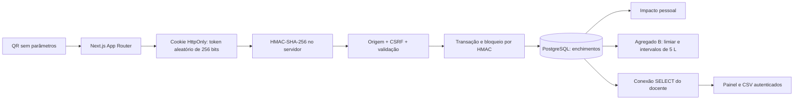

# Arquitetura e proteção de dados

## Fluxo

Next.js 16 / React 19, TypeScript estrito, Tailwind CSS 4, Prisma ORM 7 com adaptador `pg`, PostgreSQL. Versões exatas resolvidas no `package-lock.json`. Código de serviço em `src/lib`, HTTP em `src/app/api`, interface em `src/components`. Não há serviços de analytics, fontes remotas nem imagens de terceiros. SVGs próprios e QR gerado no servidor.

## Inventário mínimo

A única tabela de participação é `enchimentos`: `id UUID`, `token_hash CHAR(64)`, `curso VARCHAR(120)`, `quantidade_litros DECIMAL(5,2)` e `created_at TIMESTAMPTZ(3)`. Três índices independentes: hash, curso, data. Prisma pode criar `_prisma_migrations`, que contém apenas metadados técnicos de migração. Não há tabela de utilizadores, atribuições, sessões, metas, estações ou eventos de navegação.

O servidor gera 32 bytes com `crypto.randomBytes`. Entrega o token num cookie próprio, host-only, Path=/, HttpOnly, SameSite=Strict, com validade fixa de 90 dias por omissão. Não renova cookies existentes no primeiro acesso subsequente. Produção usa Secure e prefixo `__Host-`. Apenas `HMAC-SHA-256(chave secreta, token)` é persistido. HMAC não é encriptação nem permite recuperar o token. A chave tem pelo menos 32 bytes aleatórios e está fora da BD; não a rodar durante o estudo, pois tal perde a ligação aos históricos e muda a atribuição.

O identificador técnico do registo é um UUID derivado de SHA-256(HMAC + UUID de submissão), com bits de formato fixos. Assim o mesmo pedido do mesmo navegador tem o mesmo `id` sem adicionar uma coluna pessoal. O UUID de submissão é criado no cliente e não identifica uma pessoa.

O navegador recebe apenas dados pessoais próprios, CSRF opaco e, em B, agregado protegido. Nunca recebe `token_hash`. O docente pode receber o HMAC na exportação autorizada. O código `server-only` impede que serviços de BD e autenticação sejam importados no cliente.

## Atribuição e exposição

`parseInt(token_hash.slice(0,2),16) % 2 === 0 ? 'A' : 'B'`. Cada token criptográfico tem probabilidade aproximada de 1/2 em cada grupo, independentemente do curso. Não existe coluna de versão nem opção de forçar grupo na API. A mesma função é usada no painel e CSV; o SQL coletivo usa a paridade do primeiro byte da descodificação hexadecimal.

O conteúdo, metas, formulários, estimativas e percurso são partilhados. Só `CollectiveLake` e os dados que o alimentam se acrescentam em B, em `/impacto`. A não consulta nem recebe agregados coletivos. A atribuição é estável enquanto o cookie e a chave HMAC forem conservados; o agrupamento por curso pode mudar se a pessoa escolher outro curso. O lago usa o último curso registado pelo navegador e os registos B atribuídos a esse curso; o histórico pessoal inclui todos os cursos escolhidos.

## Controlo dos pedidos

- `Origin` deve coincidir exatamente com `APP_ORIGIN`; não confiamos em Host ou X-Forwarded-Host fornecido pelo cliente. Não permitir CORS externo.
- Mutações exigem JSON e header `X-CSRF-Token`, assinado e vinculado ao token HttpOnly, além de SameSite=Strict e rejeição de Fetch Metadata cross-site. O endpoint inicial de sessão usa origem + JSON e não altera dados de participação.
- Zod no servidor: curso da lista, número finito entre 0,10 e 5 L, no máximo duas casas decimais, UUID válido, sem campos extra. Limite de corpo de 4 KiB aplicado durante leitura do stream. Configurar também limite no proxy.
- Todas as queries usam Prisma ou SQL parametrizado. React escapa texto. CSP com nonce, sem inline scripts arbitrários; estilos inline são permitidos para os progressos. Não existe `dangerouslySetInnerHTML`.
- Transação com advisory lock PostgreSQL por hash serializa submissões concorrentes e eliminações. Repetição do mesmo ID e conteúdo devolve o registo existente. Mesmo ID e conteúdo diferente dá 409. Pedidos com IDs distintos respeitam intervalo de 45 s, 20 registos e 20 L por dia UTC. Colisões do lock podem serializar dois tokens, sem misturar registos.
- A hora vem de `clock_timestamp()` do PostgreSQL; a BD tem `DEFAULT CURRENT_TIMESTAMP` e restrição de intervalo de litros. O cliente não decide timestamps ou A/B.
- Pedidos e páginas personalizados usam no-store. CSV e JSON não devem ser guardados num CDN. Erros públicos são genéricos; os logs da aplicação contêm apenas o código fixo de indisponibilidade.

Não se consegue impedir abuso por renovação de cookies sem maior identificação. Idempotência é garantida enquanto o registo existir; após eliminação ou retenção não mantemos um ledger adicional. Uma submissão antiga reenviada depois de eliminar pode voltar a ser um registo novo. Não usar o sistema para certificar consumo físico.

## Docente e base de dados

Credenciais do docente em variáveis de ambiente: nome de utilizador e hash scrypt com salt aleatório. Comparação de tamanho fixo e sessão assinada com 4 horas de validade, cookie HttpOnly, Secure em produção e SameSite=Strict. Logout apaga o cookie. Um cookie roubado continua válido até expirar; a aplicação não conserva uma lista de sessões revogadas. Rodar SESSION_SECRET revoga todas as sessões, incluindo CSRF, e obriga a recarregar páginas.

Limite global de 10 tentativas de login por 15 minutos, partilhado em PostgreSQL, sem IP ou nomes de utilizador. `admin_login_throttle` é uma tabela técnica com uma única linha e, no máximo, dez timestamps globais. Um bloqueio de linha em transação serializa tentativas de todas as instâncias; os reinícios do servidor não repõem o contador. Timestamps expirados são retirados na tentativa seguinte e pela retenção diária na Vercel. O limite pode bloquear temporariamente todos os logins do docente.

`reviravolta_owner`: apenas migrações/operação; `reviravolta_app`: SELECT, INSERT, DELETE nos enchimentos, sem UPDATE/DDL, e SELECT/UPDATE apenas em `admin_login_throttle`; `reviravolta_reader`: só SELECT nos enchimentos e default_transaction_read_only=on, sem acesso à tabela do limite. O painel usa sempre RESEARCH_DATABASE_URL e transação read-only; não há endpoints de alteração administrativa. O script `db:roles` instala estes privilégios. Em produção não usar superuser na aplicação. O processo Next contém as duas ligações: a separação limita bugs de autorização, não protege contra compromisso total do servidor.

## Agregados e inferências

Contar pelo menos MIN_COURSE_PARTICIPANTS HMACs B distintos antes de publicar qualquer total de curso (mínimo permitido: 5). Abaixo do limiar não devolver litros nem contagem. Acima, arredondar para baixo em intervalos de 5 L, claramente apresentados como limite inferior. A League Table do docente também suprime células curso/semana abaixo do limiar. O docente continua autorizado a ler o CSV individual.

Estes mecanismos não são privacidade diferencial e não eliminam inferência por diferenças, observação temporal ou conhecimento externo. Não existe ranking público. Reavaliar tamanho mínimo, precisão e frequência antes de produção. O lago pode descer por retenção ou eliminação; isso é explicado e não é uma penalização.

## Retenção, direitos e infraestrutura

Por omissão, 90 dias por registo. Consultas de impacto e investigação excluem dados expirados; a tarefa diária remove-os fisicamente. Agendar `npm run db:retention` pelo menos uma vez por dia. Pode existir atraso de até um ciclo no armazenamento físico; falhas da tarefa exigem alerta operacional sem incluir dados. No fim: `npm run db:retention -- --all --confirm-project-end` e remoção dos volumes/backups/exportações pelo operador, com registo de conclusão sem identificadores.

O botão de eliminação exige confirmação e elimina apenas os registos cujo HMAC corresponde ao cookie. Mantém o cookie e a versão A/B. Apaga a meta opcional local. Se se perder o cookie não há recuperação; não pedir que seja enviado por email. Exportações e backups não são apagados remotamente: definir uma janela curta de expiração, impedir restauração de dados apagados sem reaplicar eliminações e documentar o procedimento institucional.

Antes da recolha real configurar PROJECT_CONTROLLER, PROJECT_CONTACT e PROJECT_LAWFUL_BASIS. `DATA_MODE=study` recusa arrancar sem eles e só permite novos enchimentos em [STUDY_START, STUDY_END). A instituição valida o fundamento, informação ao titular, contrato de subcontratação, região e eventuais transferências; a aplicação não determina conformidade RGPD por si só.

HTTPS obrigatório em produção. Desativar logs de acesso que guardem IP, User-Agent, Referer, URL/query, cookies e cabeçalhos. Nginx: `access_log off;` e encaminhar apenas erros previamente sanitizados; rever também logs do load balancer/CDN/WAF/provedor. Evitar capturas automáticas de pedidos/erros. PostgreSQL deve ter `log_statement=none`, `log_min_error_statement=panic`, `log_parameter_max_length_on_error=0`, `log_connections=off`, `log_disconnections=off`; rever `log_line_prefix` e auditoria gerida. Logs de infraestrutura podem tratar IPs apesar do código da aplicação: verificar a configuração efetiva.

## Referências técnicas

- [Next.js: CSP com nonces](https://nextjs.org/docs/app/guides/content-security-policy).
- [Prisma ORM 7: configuração](https://www.prisma.io/docs/orm/v7/reference/prisma-config-reference).
- [OWASP: proteção CSRF](https://cheatsheetseries.owasp.org/cheatsheets/Cross-Site_Request_Forgery_Prevention_Cheat_Sheet.html).
- [RGPD, texto oficial](https://eur-lex.europa.eu/eli/reg/2016/679/oj?locale=pt).
